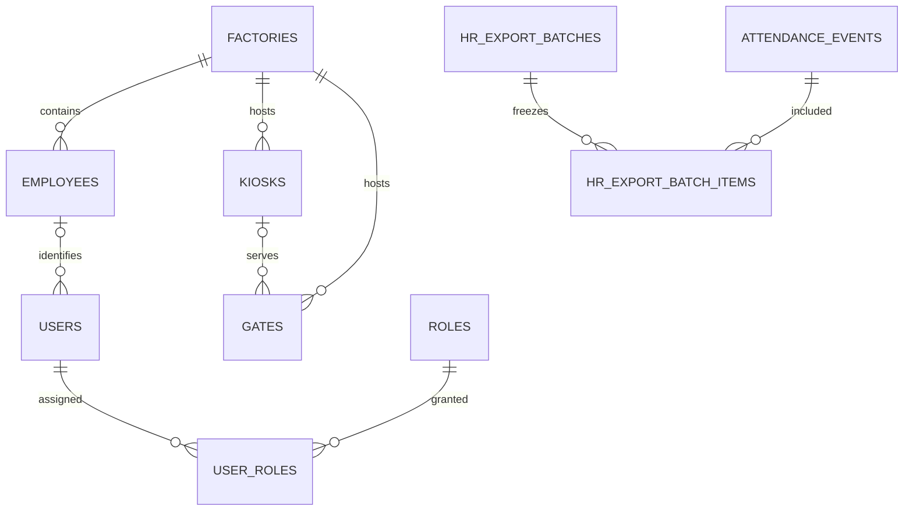
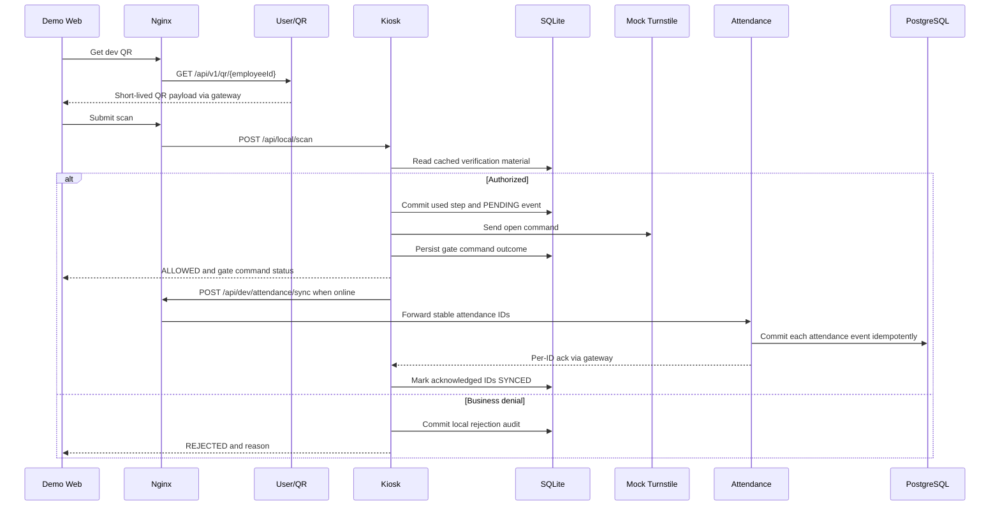

# M2 review and submission draft

Repository URL from the local Git configuration: [TMC QR Attendance System](https://github.com/lamphnam/tmc-qr-attendance-system).
Use the merged commit in the submission. The local checkout contains review changes that still need owner approval.

## Scope and architecture

The M2 implementation focuses on the dev Main Flow in B28. A dynamic QR and the cached whitelist let the kiosk
authorize locally during a central outage. The four Central services share PostgreSQL. The kiosk commits to its own
SQLite database and calls the local turnstile adapter. The HTTP sync worker retries with the same attendance ID.
[Architecture and ADRs](ARCHITECTURE.md) · [Official tasks and team plan](PROJECT.md#4-m2-deliverables).

| Style considered | Fit for TMC | Trade-off |
|---|---|---|
| Central monolith | Simple central deployment and transactions | Coarser change boundary across QR, gate, attendance and reporting; an independent edge still needed for offline scanning |
| Fine-grained microservices with separate stores | Independent storage and evolution | Distributed consistency, more deployments and more integration work for the two-factory scope |
| Service-based Central + offline kiosk (selected) | Four bounded domain runtimes, one ACID reporting/ingestion store, local gate fast path | Shared SQL ownership needs discipline; cached revocations lag during an outage; queue/retry and clock skew need tests |

### Module view

The Java dependency direction is `presentation → application → domain ← infrastructure`. The domain owns its ports.
The [class map](TRACEABILITY.md#java-class-map) shows the implemented packages. This DSM shows the dev runtime
dependencies by client row. The gateway entry for Gate Station covers routing and health.

| Client ↓ / dependency → | Web | Gateway | User/QR | Gate Station | Attendance | Reporting | Kiosk | PG | SQLite | Turnstile | HR |
|---|---|---|---|---|---|---|---|---|---|---|---|
| Web | | ✓ | | | | | | | | | |
| Gateway | ✓ | | ✓ | ✓ | ✓ | ✓ | ✓ | | | ✓ | ✓ |
| User/QR | | | | | | | | ✓ | | | |
| Gate Station | | | | | | | | ✓ | | | |
| Attendance | | | | | | | | ✓ | | | |
| Reporting | | | | | | | | ✓ | | | ✓ |
| Kiosk | | ✓ | | | | | | | ✓ | ✓ | |

The Central foreign keys in [schema.sql](../init-db/schema.sql) relate the following records:

Attendance facts carry employee, factory and gate IDs without physical foreign keys so delayed edge facts survive
changes to Central reference data. Audit rows link by hash. Kiosk tables remain in local SQLite. [Data model](DATA-MODEL.md).

### Component-and-connector view

The [recovery and monthly export sequences](RUNTIME-FLOWS.md) describe the operator workflows and error paths.
Reporting reads Central data and uses a stable ID at the HR boundary. A missed scheduled export discovered after
the default 06:00 cutoff is marked FAILED for operator review. Manual rearm preserves its ID and frozen attendance
items.

### Allocation view

The [Compose definition](../docker-compose.yml) deploys the four Central services, PostgreSQL, gateway and frontend
with an independent kiosk, SQLite volume and two mocks. This simulates the production split between factory LAN and
central deployment on one development machine. The [owner table](OWNERSHIP.md#owners-team-plan-sa_btl_m2-rows-48)
maps the allocation to team responsibilities.

## SOLID reflection

- **SRP and DIP.** Scan parsing belongs to `KioskScanController`, the TOTP window belongs to
  `TotpValidatorDomainService`, and transaction ordering belongs to `ProcessQrScanUseCase` and its storage port.
  The HMAC implementation stays in infrastructure. The extra port costs one small interface and adapter, and allows
  a framework-free domain guarded by ArchUnit.
  [Scan use case](../kiosk-agent/src/main/java/vn/edu/hcmut/tmc/kiosk/application/usecase/ProcessQrScanUseCase.java).
- **OCP and LSP.** The turnstile port lets the kiosk orchestrate a gate command without HTTP details. Its outcome
  separates command acceptance from physical confirmation. The repo exercises the HTTP mock adapter, so a hardware
  replacement would still require contract tests and operational evidence.
  [Turnstile port](../kiosk-agent/src/main/java/vn/edu/hcmut/tmc/kiosk/domain/port/ITurnstileAdapter.java).
- **ISP and transaction cost.** The local whitelist reader and snapshot updater expose separate capabilities. The
  attendance adapter shares one transaction for event and replay consumption to make concurrent scans safe. A separate
  rejection table keeps the Central ingestion contract stable, at the cost of local retention and review work.
  [SQLite adapter](../kiosk-agent/src/main/java/vn/edu/hcmut/tmc/kiosk/infrastructure/persistence/SQLiteAttendanceRepository.java).

See [SOLID evidence](SOLID-GUIDELINES.md#5-solid-evidence) for test and limitation labels.

## Acceptance and owner review

Use the commands and results in [STATUS](STATUS.md) and the evidence rules in [TESTING](TESTING.md). T01 and T06 require
their own workload and latency figures. T02 requires matching the same ID set before and after recovery. Browser
review should show revoke, whitelist refresh, rejection of the prior QR and activation for the next run.

| Reviewer | Decision or evidence |
|---|---|
| Khánh and Khôi | Scan and sync evidence, D06 retention and any Central rejection replication |
| Khoa and Khiêm | B32 QR payload wording, browser lifecycle and demo screenshots |
| Nam | HR cutoff behavior, NFR measurements, final report and GitHub commit |
| Team | Scope cut under B28, missing production features, reviewed submission uploaded to LMS |

Production auth, gate-station/manual-open, HR employee sync and role-protected portals remain documented design work.
Use the [known limitations](DECISIONS.md#known-limitations) when stating the implementation result.
