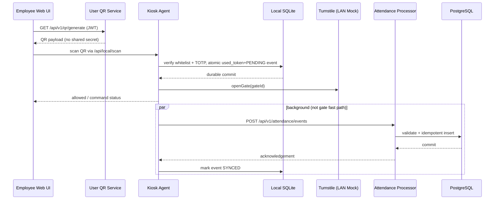
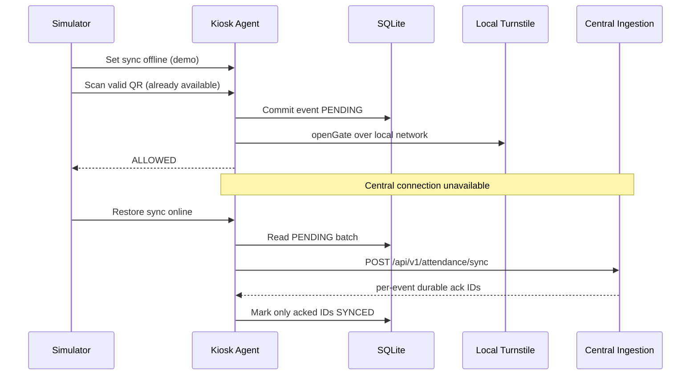
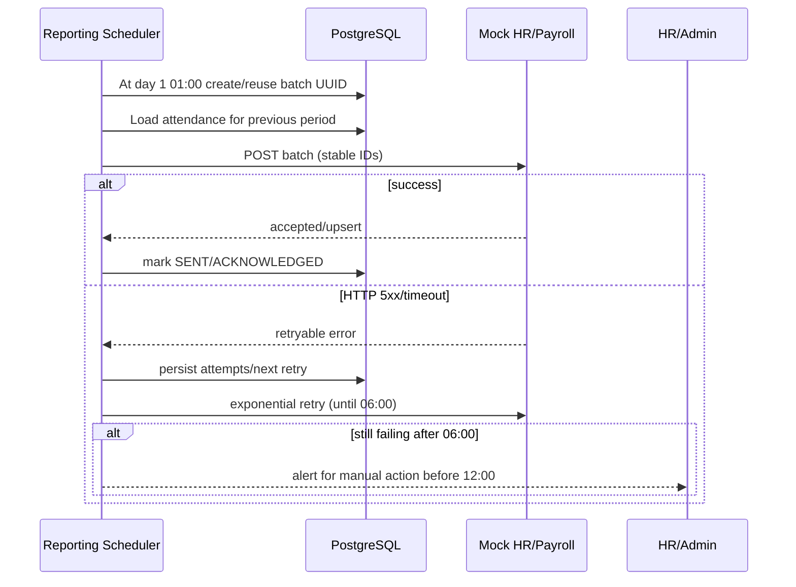

# RUNTIME-FLOWS — runtime flows, error handling, sequence notes

Decisions behind these flows: [ARCHITECTURE](ARCHITECTURE.md) (ADR-01..03). Wire formats: [API-CONTRACTS](API-CONTRACTS.md). Tests that exercise them: [TESTING](TESTING.md).

## Flow A — Obtain dynamic QR and scan online [BASELINE-M1 + TEAM-PLAN]

- QR expires on TOTP step boundary; reject stale/invalid/duplicate locally.
- When turnstile returns error after local commit, preserve event + gate command failure info; don't falsely report physical opening.
- Central ack delayed/lost AFTER commit → retry same `attendanceId`; no duplicate insert.

## Flow B — Lost WAN + recovery [BASELINE-M1]

- The network toggle disables **only central API sync**, never the same-host mock turnstile.
- Offline scanning needs a QR already displayed/cached or a securely mobile-generated TOTP; the employee web cannot fetch a **new** QR from central during a WAN outage.
- The whitelist must have been synced before going offline; revocations reach an isolated kiosk only at the next sync.
- The 20-scan offline scenario and the lost-ack case are specified in [TESTING](TESTING.md) T02.

## Flow C — Monthly HR/Payroll Export [BASELINE-M1]

- `POST /api/v1/reports/hr-export/trigger` (protected HR/Admin) is a **demo bypass of the schedule**, not a different data contract. Persisted batch state must allow retry after a restart (tests: [TESTING](TESTING.md) T05).

## Flow D — Security Guard manual gate [BASELINE-M1 scope, DRAFT mechanism]

1. Guard authenticated + authorized role sends gate ID and reason.
2. Gate Station Service validates role, gate operational status, records request ID and audit event.
3. Gate command must reach kiosk over a defined authenticated channel; **not yet specified by M1**. Demo may use mock adapter and document this explicitly.
4. Log success/failure acknowledgement, do not just call gate open while ignoring unauthorized access.

## Error matrix

| Event | Local action | Central action | Expected user/admin effect |
|---|---|---|---|
| Bad TOTP | do not open; log rejected | optional reject event sync | clear denial |
| Duplicate local TOTP step | do not open; log rejected | optional reject event sync | replay blocked |
| WAN outage | PENDING persists; attempt local open | none | status PENDING visible |
| HTTP 5xx/timeout | retry later, same IDs | atomic idempotent persist | no duplication |
| Permanent 4xx schema issue | FAILED + alert; preserve record | return per-event failure | manual investigation |
| Central commits then response lost | retain PENDING until retry ack | return duplicate success on retry | eventual SYNCED |
| Turnstile adapter unavailable | retain event plus failure status | sync event eventually | no false 'gate opened' |
| Kiosk restart | SQLite queue survives | no change | background sync resumes |

**Definition:** `PENDING/SYNCED/FAILED` denotes *central synchronization status*, not physical gate open status. Use separate `gateCommandStatus` if needed.
